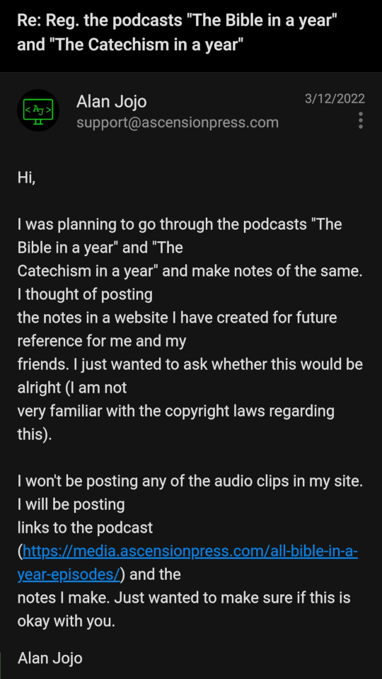
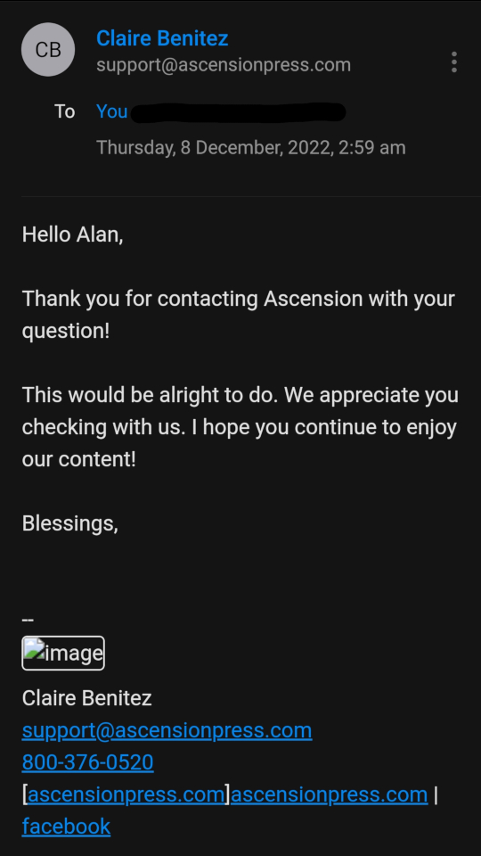

---
date:
  created: 2026-10-24
authors:
  - alan
categories:
  - Announcements
slug: posting-biy-and-ciy
---

# Posting notes on BIY and CIY
I have been trying to follow the podcasts *The Bible in a Year* and *The Catechism in a Year* hosted by Fr. Mike Schmitz (Ascension Presents) for quite some time. As you might realise, it's been quite some time and I have been sidetracked whenever I start. Hope I can finish this one day. Will be making notes while listening to the podcast to post on this site.

<!-- more -->

  {loading=lazy}

  {loading=lazy}

The links for the podcasts on the official website are given below:

[The Bible in a Year](https://app.ascensionpress.com/podcasts/bible){.md-button target=_blank}
[The Catechism in a Year](https://app.ascensionpress.com/podcasts/catechism){.md-button target=_blank}

These are also available on YouTube in the following channels:

[YouTube - BIY](https://www.youtube.com/@TheBibleinaYear/playlists){.md-button target=_blank}
[YouTube - CIY](https://www.youtube.com/@TheCatechismInAYear/playlists){.md-button target=_blank}

Subscribe to these channels to follow the podcasts.

---

Will also try adding relevant notes I find while reading *Haydock's Catholic Bible Commentary*. I searched through the web for some time and am pretty sure that this belongs to public domain. I don't know who to ask about the copyright information regarding this commentary. If you do, please [inform me](mailto:Godlovesalanjojo@gmail.com). Read about this Bible commentary from [Catholic Ebooks Project](https://catholicebooks.wordpress.com/2017/09/30/online-ebook-haydocks-catholic-bible-commentary-1859-edition/){ target=_blank }.

#### Bibliographical information

Haydock, George Leo. "Haydock's Catholic Bible Commentary". <https://web.archive.org/web/20160422023253/http://haydock1859.tripod.com/>. 1859.
